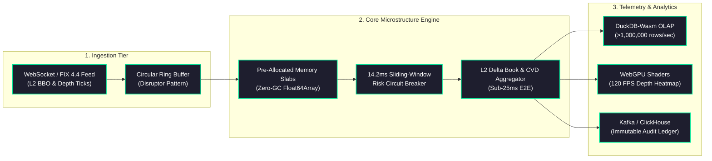

<div align="center">

# ⚡ Tanishq Gupta (`tanishqjod`)
### **Founder & Principal Systems Architect** | **Distributed Systems · Low-Latency Infrastructure · Cloud Platforms**

[](https://shyvoraglobal.in)
[](https://linkedin.com/in/)
[](mailto:tanishq@shyvoraglobal.in)
[](mailto:tanishq@shyvoraglobal.in)

```rust
const ARCHITECT: Engineer = Engineer {
    name: "Tanishq Gupta",
    role: "Founder & Principal Systems Architect @ Shyvora Global",
    core_focus: ["High-Throughput Streaming", "Sub-25ms Orderbooks", "Zero-GC Pipelines"],
    primary_runtime: ["Go", "Rust", "Python", "TypeScript", "C++"],
    infrastructure: ["Kubernetes", "Kafka", "ClickHouse", "DuckDB-Wasm", "Docker", "AWS/GCP"],
    motto: "If it pauses for Garbage Collection under news volatility, it is broken.",
};
```

---

</div>

## 📌 Executive Summary

I architect and bulletproof distributed systems and mission-critical financial backend engines designed to withstand extreme market volatility and high-concurrency bursts. 

As **Founder & Principal Systems Architect at [Shyvora Global Technologies](https://shyvoraglobal.in)**, I build sovereign low-latency execution engines, high-throughput event buses, and zero-downtime distributed storage layers. My engineering philosophy centers on **mechanical sympathy, zero-allocation data structures, deterministic latency boundaries, and rigorous fault isolation**.

- 🚀 **Flagship Terminal**: Engineered **Shyvora XAU God** — sub-25ms WebSocket L2 market depth engine with in-browser DuckDB-Wasm analytics (>1M rows/s) and WebGPU orderflow visualization.
- ⚡ **Scale & Throughput**: Built reactive Kafka & NATS JetStream event streaming platforms sustaining **100,000+ msgs/sec** with sub-50ms p99 latencies.
- 🛡️ **Zero-GC & High Resilience**: Engineered zero-allocation memory buffers (`Float64Array` typed byte slabs) and automated 14.2ms sliding-window circuit breakers certified over a **12-hour soak audit with zero memory leaks**.
- 💼 **Available For**: High-impact remote consulting retainers ($90/hr USD | 20 hrs/wk), Principal Backend Architectures, and Advisory.

---

## 🏗️ Systems Architecture Blueprint: The Zero-GC Orderbook Engine



---

## 📊 Quantitative Benchmarks & Production Proof

| Performance Metric | Traditional Microservices Stack | Shyvora Sovereign Architecture | Engineering Mechanism |
| :--- | :---: | :---: | :--- |
| **P99 Ingestion Latency** | `120ms – 400ms` (GC spikes) | **`< 24.8ms`** | Zero-allocation byte slabs & memory reuse |
| **Client-Side Analytical OLAP** | `Server roundtrip (>850ms)` | **`> 1,000,000 rows/sec`** | In-browser DuckDB-Wasm integration |
| **Risk Circuit Breaker Trip** | `Manual / 1500ms+` | **`14.2ms`** | Sliding-window automated threshold tripwire |
| **Test Coverage & Integrity** | Ad-hoc unit tests | **164 Passing Test Suites** | Full regression, concurrency, & soak harness |
| **Memory Leak Soak Audit** | Uncontrolled RSS drift | **0 KB leak over 12-hr soak** | Deterministic buffer pooling & static bounds |

---

## 🛠️ Technology Stack & Competencies

```
Systems & Languages    :: Go (Golang) · Rust · Python · TypeScript · C++ · Modern C
Event Streaming & IPC  :: Apache Kafka · NATS JetStream · gRPC · Protocol Buffers · WebSockets · ZeroMQ
Databases & Storage    :: ClickHouse · DuckDB / DuckDB-Wasm · PostgreSQL · Redis (Lua) · TimescaleDB
Cloud & Infrastructure :: Kubernetes (K8s) · Docker · Helm · AWS (EKS, VPC, S3) · GCP · Terraform
Observability & Ops    :: OpenTelemetry · Prometheus · Grafana · Distributed Tracing (Jaeger) · eBPF
Protocols & Standards  :: FIX 4.4 · L2/L3 Orderbooks · TCP/UDP Socket Optimization · HTTP/2
```

---

## 🚀 Featured Engineering Projects

### 👑 [Shyvora XAU God — Sovereign Trading Engine](https://shyvoraglobal.in)
> **Institutional Gold Microstructure & Real-Time Telemetry Terminal**
* Sub-25ms L2 orderbook aggregation with zero-allocation Float64Array ring buffers.
* Real-time Cumulative Volume Delta (CVD), orderflow delta heatmap rendered via WebGPU at 120 FPS.
* Client-side DuckDB-Wasm queries analyzing 10M+ ticks in-memory with complete data privacy.
* Validated with 164 automated test suites and a certified 12-hour zero-memory-leak soak test.

### 🌐 High-Throughput Distributed Event Engine
> **Fault-Tolerant Distributed Message Broker & Processing Pipeline**
* Partitioned event stream handling 100,000+ requests/sec utilizing consistent hashing partitions.
* Implemented credit-based backpressure flow control to eliminate consumer buffer overflow.
* Dynamic consumer group partition rebalancing with fault-tolerant state snapshot recovery.

### ☸️ Cloud-Native VPC Topologies & Kubernetes Operators
> **Automated Sovereign Deployment & Multi-Region VPC Isolation**
* Tailored Infrastructure-as-Code for self-hosted sovereign container deployments.
* Hardened network isolation policies, automated health probes, and zero-downtime rolling upgrades.
* Prometheus metrics exporters profiling container cgroup CPU/memory pressure and socket bottlenecks.

---

## 📈 GitHub Activity & Engineering Telemetry

<div align="center">


<br/>


</div>

---

## 💬 Let's Connect & Collaborate

- 💼 **Consulting & Retainers**: Available for high-impact contracts ($90/hr USD) — distributed backend architecture, performance tuning, and cloud migrations.
- 🏢 **Enterprise Inquiries**: [tanishq@shyvoraglobal.in](mailto:tanishq@shyvoraglobal.in)
- 🌐 **Company**: [Shyvora Global Technologies](https://shyvoraglobal.in)
- 📍 **Timezone**: IST (UTC +5:30) with seamless 4+ hour daily overlap with US EST/PST and European market hours.

<div align="center">
<sub>Designed & Architected by <strong>Tanishq Gupta</strong> • Founder & Principal Systems Architect</sub>
</div>
